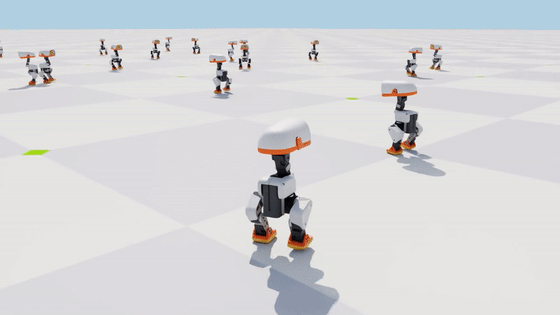
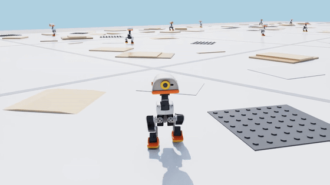
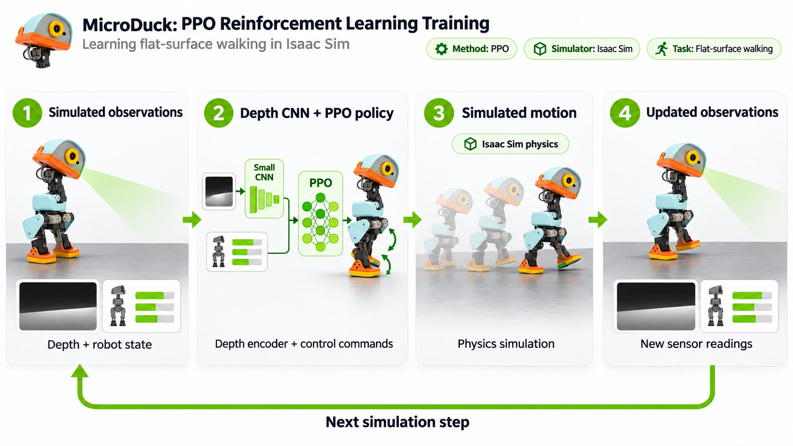
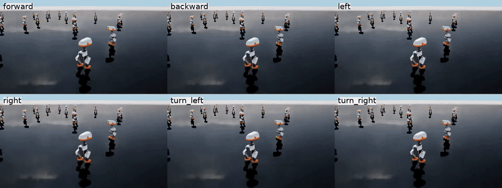
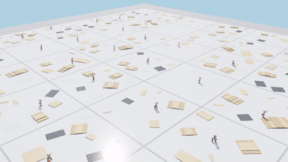

<div align="center">

# 🦆 MicroDuck Walk

### Teaching a tiny bipedal robot to walk with Reinforcement Learning in NVIDIA Isaac Sim


-blue)


 

*Left: walking on flat ground (v6). Right: walking over ramps, platforms and studded mats with a depth camera (v7).*

</div>

---

## ✨ Overview

**MicroDuck** is Pollen Robotics' small open-source biped: **25 cm tall, 0.74 kg**, driven by Dynamixel XL330 servos.
This project trains walking policies for it **entirely in simulation** with **PPO** on thousands of robots in parallel
in **NVIDIA Isaac Sim 6.2 / Isaac Lab 3.0**.

- 🦿 **Flat-surface walker (v6)**: velocity tracking (forward/backward, sideways, turning) plus head-pose control.
- 🧗 **Obstacle-course walker (v7)**: the same walker with a **head-mounted depth camera** and a **CNN encoder**,
  trained on a procedural course of stairs, ramps, platforms, studded mats and metal plates, with a terrain curriculum.
- ⚙️ **Realistic servos**: the XL330 actuator model from **BAM** (*Better Actuator Models*) runs as an Isaac Lab
  explicit actuator, so the policy learns with realistic torque and friction limits.
- 🪞 **Symmetric gaits**: PPO with a **mirror loss** encourages left/right symmetric walking.

## 🧠 How training works

<div align="center">

</div>

1. 👀 **Observe**: IMU (angular velocity and gravity), joint positions and velocities, last action, velocity
   command, head-pose command, and for v7 a **32×24 depth image** from the head camera.
2. 🧩 **Decide**: a small **CNN** encodes the depth image (v7). Its features and the robot state feed a
   **[512, 256, 128] MLP** policy trained with **PPO**.
3. 🏃 **Act**: joint targets go to the BAM servo model, and **Isaac Sim PhysX** simulates the motion.
4. 🔁 **Repeat**: new observations arrive. Thousands of robots train in parallel on a single GPU.

## 🎬 Results

### 🟩 Flat surface (v6)

<div align="center">


*One robot under each fixed command: forward, backward, left, right, turn left, turn right.*
</div>

### 🟫 Obstacle surface (v7)

<div align="center">


*Many robots training on the procedural course, one robot per 3×3 m tile, harder rows further away.*
</div>

### 📊 Evaluation

| Policy | Robots × time | Falls | Command tracking score* | Turning (±0.8 rad/s) | Forward/backward (±0.3 m/s) |
|---|---|---|---|---|---|
| 🟩 **v6 flat** | 256 × 60 s | **0** (0 % of robots) | 63.2 / 100 | ✅ ~100 % | ~0.17 m/s achieved |
| 🟫 **v7 obstacle** | 256 × 60 s | 0.55 per robot-minute (34 % fell at least once) | 60.6 / 100 | ✅ ~100 % | ~0.17 m/s achieved |

<sub>*Score = % of robots still standing × % of the commanded velocity reached, averaged over 7 fixed commands
(stand, forward, backward, left, right, turn left, turn right), from <code>scripts/eval_dirs.py</code>.
Sideways walking (±0.2 m/s) is the weakest skill of both policies (~20 % tracking).</sub>

| | v6 flat | v7 obstacle |
|---|---|---|
| Parallel robots | 4096 | 4096 |
| PPO iterations | 3000 | 4000 |
| Training time (1× NVIDIA L40S) | ~53 min | ~2 h |

## 📦 Pretrained weights

Only the **final** checkpoints are included:

```
weights/
├── flat_v6/        # Microduck-Walk-V6, iteration 2999
│   ├── model_2999.pt          # RSL-RL checkpoint (resume / play)
│   ├── policy.pt              # TorchScript actor (deployment)
│   ├── policy.onnx(+ .data)   # ONNX actor (deployment)
│   └── params/                # exact env.yaml + agent.yaml used for training
└── obstacle_v7/    # Microduck-Walk-V7, iteration 3999 (depth camera + CNN)
    ├── model_3999.pt
    ├── policy.pt
    ├── policy.onnx(+ .data)
    └── params/
```

## 🚀 Getting started

### 1. Install Isaac Sim 6.2 + Isaac Lab 3.0

Follow the [Isaac Lab installation guide](https://isaac-sim.github.io/IsaacLab/), then install this package into
the same environment. It registers its tasks through the `isaaclab.tasks` entry point:

```bash
git clone https://github.com/KiaRational/Microduck_Walk.git
cd Microduck_Walk
pip install -e . --no-deps          # or: uv pip install -e . --no-deps
```

### 2. Watch the pretrained walkers 👀

```bash
# flat ground
isaaclab play --rl_library rsl_rl --task Microduck-Walk-V6-Play --checkpoint weights/flat_v6/model_2999.pt --viz kit
# obstacle course with depth camera
isaaclab play --rl_library rsl_rl --task Microduck-Walk-V7-Play --checkpoint weights/obstacle_v7/model_3999.pt --viz kit
```

### 3. Train your own 🏋️

```bash
isaaclab train --rl_library rsl_rl --task Microduck-Walk-V6 --num_envs 4096 --max_iterations 3000   # flat
isaaclab train --rl_library rsl_rl --task Microduck-Walk-V7 --num_envs 4096 --max_iterations 4000   # obstacles
```

### 4. Evaluate 📏

```bash
python scripts/eval_dirs.py  --task Microduck-Walk-V6-Play --checkpoint weights/flat_v6/model_2999.pt   # 7 fixed commands
python scripts/eval_walk.py  --task Microduck-Walk-V6-Play --checkpoint weights/flat_v6/model_2999.pt --num_envs 256 --seconds 60   # falls
python scripts/gait_check.py --task Microduck-Walk-V6-Play --checkpoint weights/flat_v6/model_2999.pt   # foot contact stats
python scripts/record_policy.py --task Microduck-Walk-V6-Play --checkpoint weights/flat_v6/model_2999.pt   # overview video
```


## 🗂️ Project structure

```
microduck_lab/
├── robot.py              # MicroDuck articulation (HOME pose, PD and BAM servo variants)
├── bam.py                # XL330 servo model (BAM) as an Isaac Lab explicit actuator for PhysX
└── tasks/
    ├── walk_v5.py        # reference MicroDuck velocity task (rewards, observations, head-pose command, mirror loss)
    ├── walk_v7.py        # + head depth camera, CNN encoder, stairs/ramps/props terrain + curriculum
    ├── course.py         # procedural obstacle course (stairs, ramps, platforms, mats, plates, props)
    ├── gait_mdp.py       # gait rewards: air time, foot clearance, swing height, foot slip, upright, posture
    ├── agents.py         # PPO / RSL-RL runner configs (MLP and CNN models)
    └── nav_env_cfg.py    # (experimental) depth-camera goal navigation on top of a frozen walker;
                          #   needs an exported walker at assets/walk_v2_policy.pt (not included)
assets/                   # MicroDuck MJCF + converted USD
scripts/                  # evaluation, recording and debugging tools
weights/                  # final pretrained policies
media/                    # GIFs and figures
```

## 🛤️ Version history

| Version | What changed |
|---|---|
| v1 | Isaac Lab velocity task on flat ground: learned a fast foot shuffle |
| v2 | Gait rewards ported from the official MicroDuck task, walk-over obstacle course |
| v3–v4 | Reference reward recipe, BAM XL330 servo model |
| v5 | Full port of the reference MicroDuck velocity task (actuated head, head-pose command, mirror loss) |
| **v6** | **v5 trained on Isaac Sim PhysX: final flat-ground walker** |
| **v7** | **v6 + head depth camera + CNN + stairs/ramps/props with terrain curriculum: final obstacle walker** |

## 🙏 Acknowledgements

This project stands on the shoulders of these open-source projects. Huge thanks to their authors:

- 🦆 [pollen-robotics/microduck](https://github.com/pollen-robotics/microduck): the MicroDuck robot (hardware, CAD, MJCF model)
- 🧪 [pollen-robotics/microduck_rl](https://github.com/pollen-robotics/microduck_rl): the reference RL training recipe for MicroDuck
- 🔁 [rocPAI-Forge/microduck_rl_unilab](https://github.com/rocPAI-Forge/microduck_rl_unilab): reproduction of the reference task configuration
- ⚙️ [Rhoban/bam](https://github.com/Rhoban/bam): Better Actuator Models, the XL330 servo model
- 🛠️ [Rhoban/onshape-to-robot](https://github.com/Rhoban/onshape-to-robot): CAD-to-robot model export
- 🧰 [mujocolab/mjlab](https://github.com/mujocolab/mjlab): the MuJoCo-based RL framework behind the reference training
- 🟩 [isaac-sim/IsaacLab](https://github.com/isaac-sim/IsaacLab) and [NVIDIA Isaac Sim](https://developer.nvidia.com/isaac/sim): simulation and RL framework, including the official MicroDuck task the gait rewards are ported from
- 🧠 [leggedrobotics/rsl_rl](https://github.com/leggedrobotics/rsl_rl): the PPO implementation
- 📰 NVIDIA's blog post *"Using AI agents to teach robots like Microduck to walk in simulation"*, which inspired the obstacle course

## 📄 License

The MicroDuck robot model comes from [pollen-robotics/microduck_rl](https://github.com/pollen-robotics/microduck_rl):
the **MJCF is Apache-2.0** and the **meshes are CC BY-NC-SA 4.0 (© Pollen Robotics)**. The USD files in `assets/`
are converted from those meshes, so they are also
**[CC BY-NC-SA 4.0](https://creativecommons.org/licenses/by-nc-sa/4.0/)** (non-commercial use only).

<div align="center">

⭐ If you find this project useful, consider giving it a star! ⭐

</div>
